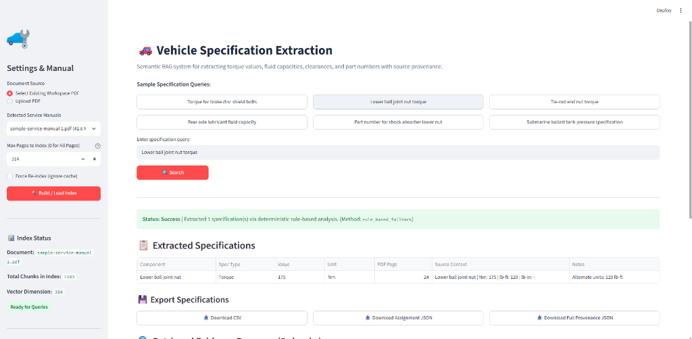

# Vehicle Specification Extraction System

An end-to-end Retrieval-Augmented Generation (RAG) system for extracting vehicle technical specifications (torque values, fluid capacities, clearances, and part numbers) from automotive service manual PDFs with full source page provenance and zero hallucination.

Built for the **Predii Vehicle Specification Extraction Assignment**.

---


## 📖 Overview & Objective

Automotive service manuals (such as the Ford F-150 Workshop Manual) contain hundreds to thousands of pages of critical technical data: torque tables, fluid specifications, clearance limits, and fastener part numbers. Mechanics and service software need immediate, reliable answers to questions like:
> *"What is the torque for the brake disc shield bolts?"*
> *"What is the lower ball joint nut tightening specification?"*

This project delivers a complete, modular, and grounded solution that:
- Ingests high-page-count automotive workshop manual PDFs.
- Preserves original 1-indexed page numbering for strict mechanical traceability.
- Cleans and chunks text while preserving tabular structures and technical units (`Nm`, `lb-ft`, `lb-in`, `qt`, `L`, `mm`, `psi`).
- Embeds passages using `sentence-transformers/all-MiniLM-L6-v2` and indexes them into a persistent FAISS vector store.
- Performs semantic retrieval and structured extraction into validated Pydantic schemas.
- Offers dual-mode extraction: **Optional LLM mode** (OpenAI / compatible) and **Deterministic Rule-Based / Tabular Fallback** (fully offline, 0 cost, 100% grounded).
- Exports results in the required assignment JSON schema, full provenance JSON, and CSV format.
- Includes an interactive **Streamlit** user interface.

---

## ✨ Key Features

- **Page-Level Provenance**: Every extracted specification cites the exact manual page number and original source context line.
- **Persistent Caching**: FAISS vector indexes and chunk metadata are hashed and saved to disk under `storage/indexes/`, avoiding costly re-indexing between sessions.
- **Deterministic Offline Fallback**: Works completely offline without requiring any external LLM API key. Accurately extracts specifications directly from automotive tabular charts and procedural text.
- **Zero Hallucination Policy**: If the manual excerpts do not contain the requested specification, the pipeline returns a clear `not_found` status rather than inventing a plausible number.
- **Dual Export Formats**:
  1. *Assignment-Compliant Format*: Clean JSON array with `component`, `spec_type`, `value`, `unit`.
  2. *Provenance Format*: Detailed JSON and CSV including page numbers, confidence score, source excerpts, and notes.
- **Configurable Chunking & Retrieval**: Sliders for `top_k` (1–15) and page limit indexing in the Streamlit UI.

---


### Detailed Pipeline Stages:
1. **Extraction**: `PyMuPDF` reads each page, retaining 1-indexed page numbers.
2. **Cleaning**: Handles strange PDF character encodings, replacement characters, and non-standard bullet symbols (`z `, ``, `•`) while preserving table column alignment.
3. **Chunking**: Splits pages into overlapping segments (default 600 characters with 120 character overlap) respecting paragraph and sentence boundaries.
4. **Vector Store**: Normalized embeddings are indexed into `faiss.IndexFlatIP` (inner product cosine similarity).
5. **Retrieval**: Semantic query vector search retrieves top-k chunks, removes duplicate passages, and filters out low similarity noise.
6. **Extraction**:
   - *LLM Mode*: Sends grounded excerpts to OpenAI-compatible endpoint with strict JSON schema instructions.
   - *Rule-Based Fallback*: Parses multi-column torque tables (`Description Nm lb-ft lb-in`), procedural tightening directives, fluid capacities, clearances, and part numbers.
7. **Validation & Output**: Pydantic models validate all types, ensuring consistent schemas.

---

## 🛠️ Technology Stack

| Component | Library / Tool | Rationale |
|---|---|---|
| **Language** | Python 3.10 | Stable, optimal compatibility with FAISS, PyMuPDF, and PyTorch |
| **PDF Extraction** | `PyMuPDF` (`fitz`) | 10x faster than `pdfminer` and `pypdf`, handles complex layouts and multi-column tables reliably |
| **Embeddings** | `sentence-transformers` (`all-MiniLM-L6-v2`) | Lightweight (80 MB), fast CPU inference, state-of-the-art semantic search for technical text |
| **Vector Store** | `faiss-cpu` | High-performance vector indexing, native persistence, fast inner-product search |
| **Data Validation** | `pydantic` (v2) | Strict runtime schema validation and serialization |
| **Data Handling** | `pandas` | Tabular manipulation and CSV generation |
| **User Interface** | `streamlit` | Clean, responsive, interactive dashboard with live progress reporting |
| **Testing** | `pytest` | Automated unit and integration testing suite |

---


---

## ⚙️ Prerequisites

- **Operating System**: Windows 10/11, macOS, or Linux.
- **Python**: Python 3.10 or 3.11 recommended. (Tested on Python 3.10.0 64-bit on Windows).
- **RAM**: Minimum 4 GB (8 GB recommended for large manual indexing).

---

## 🚀 Installation & Setup (Windows)

Open PowerShell or Command Prompt in the repository root directory:

```powershell
# 1. Navigate to the project directory
cd vehicle_spec_extraction_project

# 2. Create a virtual environment using Python 3.10
py -3.10 -m venv .venv

# 3. Activate the virtual environment
.\.venv\Scripts\Activate.ps1
# (Or in standard cmd.exe: .venv\Scripts\activate.bat)

# 4. Upgrade pip
python -m pip install --upgrade pip

# 5. Install PyTorch CPU (lightweight, avoids heavy CUDA binaries)
pip install torch torchvision --index-url https://download.pytorch.org/whl/cpu

# 6. Install all required dependencies
pip install -r requirements.txt
```

### 📸 Application Output & Dashboard:



### Using the UI:
1. **Select or Upload Manual**: The UI automatically detects `sample-service-manual 1.pdf` if present in the workspace, or you can upload any automotive PDF.
2. **Page Range**: Adjust the "Max Pages to Index" slider (`0` for the entire 852-page manual).
3. **Build / Load Index**: Click the button. A progress bar tracks text extraction, chunking, and embedding. If the manual was previously indexed, it loads instantly from cache.
4. **Query**: Click one of the quick sample query buttons (e.g. *"Lower ball joint nut torque"*, *"Torque for brake disc shield bolts"*) or type your own question.
5. **Inspect Results**:
   - View structured specifications in the interactive table (`Component`, `Spec Type`, `Value`, `Unit`, `PDF Page`, `Source Context`, `Notes`).
   - Download results as **Assignment JSON**, **Full Provenance JSON**, or **CSV**.
   - Expand the **Retrieved Evidence Passages** to verify exact source quotes and page numbers.

---


**Example Assignment JSON Output:**
```json
[
  {
    "component": "Brake disc shield bolts",
    "spec_type": "Torque",
    "value": "18",
    "unit": "Nm"
  },
  {
    "component": "Brake disc shield bolts",
    "spec_type": "Torque",
    "value": "17",
    "unit": "Nm"
  }
]
```

---

## 🎯 Evaluation & Grounding Methodology

### 1. Source Page Provenance & Traceability
Every extracted specification retains its exact 1-indexed PDF page number (`page_number`), matching the physical PDF viewer page counter rather than internal manual section footers.

### 2. Multi-Unit Technical Precision
Automotive workshop manuals frequently list specifications in both metric (`Nm`, `L`) and imperial units (`lb-ft`, `lb-in`, `pt`, `qt`). The system stores the primary unit directly in the schema and retains alternate units in `notes` (e.g., `Alternate units: 150 lb-in`).

### 3. Adjacent Row Isolation & Precision Scoring
To prevent false-positive extraction of adjacent table rows (e.g., extracting "Brake hose bracket bolt" when querying "Brake disc shield bolts"), the system implements a hybrid precision scoring function:
- **Token Containment & Jaccard Overlap**: Combines directional containment (`q_tokens ⊆ c_tokens`) with bidirectional Jaccard similarity to penalize candidates containing extra irrelevant component tokens.
- **Antonym Disqualification**: Automatically rejects conflicting spatial qualifiers (e.g., `upper` vs `lower`, `front` vs `rear`, `inner` vs `outer`).
- **Stem Normalization**: Inflection normalization (`bolts` -> `bolt`, `nuts` -> `nut`) ensures accurate matching across syntactic variants.

